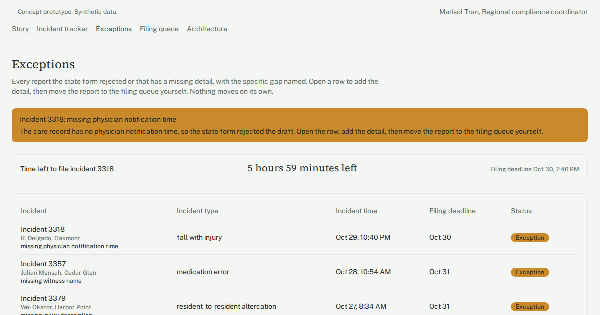

# Incident report tracker

Senior living compliance staff retype resident incidents into state forms by hand, track deadlines in a spreadsheet, and only learn about missing details when the state rejects a form.

## Who has this problem

Assisted living and memory care operators that run several communities in one region. One regional compliance coordinator usually handles every state incident filing. In the scenario we modeled, a group of 5 communities with about 420 residents files around 18 reportable incidents a month.

Incident details live in the clinical record and in Microsoft Teams messages. The coordinator retypes them into the state regulator's online form and tracks each filing deadline in a spreadsheet with no reminders. A missing detail, such as the time the physician was notified, shows up only when the form is rejected or a director gets a call. Nobody tallies rejected or late filings, so the root causes stay hidden. In our scenario this costs about 9 hours a week of re-keying and chasing directors. It also cost an estimated $11,000 over the past year in citations and corrective-action time.

## What the demo shows

The guided tour follows Marisol, a fictional regional compliance coordinator, through one morning.

1. **Meet Marisol.** The Story screen sets out her morning before and after the tool. Before: 9 open incidents, three windows open side by side, and a fall report rejected with about 6 hours to the deadline. After: one tracker with the gap already flagged.
2. **Every incident, one view.** The Incident tracker lists all open and recent reports across five communities, with the time left before each filing deadline. You can filter the list by community.
3. **Full incident history.** Click incident 3318 to see its timeline: care notes, messages and form changes in one place. You can add a timestamped note.
4. **A gap, caught early.** On the Exceptions screen, incident 3318 (a fall with a hip injury at the Oakmont community) is flagged red for "missing physician notification time." The coordinator adds the missing time and moves the report to the filing queue.
5. **The clock is visible.** A live countdown to the filing deadline, about 6 hours on first load, replaces the spreadsheet.
6. **Marisol still decides.** The Filing queue is the human checkpoint. She reads the drafted narrative and the completed fields, then clicks "Approve and file" or "Return for more info." Nothing goes to the state without that click.
7. **The numbers that matter.** A metric panel on the tracker shows open incident reports, filed on time, average hours to file and open exceptions.
8. **How this would be built.** The architecture screen maps the production system this prototype stands for.

## How it's built

- A browser-only React + TypeScript + Tailwind app built on the Umakes kit. No backend, and no real data leaves the page.
- Synthetic seed data: 80 incident reports across five fictional communities and 190 incident notes, with all dates set as offsets from the current time.
- Built and checked by the Umakes App Factory. Automated gates check the build. A reviewer then uses the app at desktop and phone sizes, clicking through every screen, action and tour step.
- The "How this would work" architecture screen shows the data flow and the compliance posture a production version would carry.

## What a production version adds

- **Real integrations.** Incident and resident data comes from Aline Care through Power Automate flows. Reports and deadlines are stored in Dataverse and SharePoint. Approval requests go through Microsoft Teams. Azure OpenAI drafts the narrative and finds missing details. A named staff member approves each filing to the state regulator portal.
- **HIPAA controls.** Role-restricted access for authorized compliance staff, full audit logging, encryption at rest and in transit, and signed BAAs with every vendor that touches resident data, including the AI drafting service. Each connected system gets only the minimum necessary data. Portal logins and multi-factor steps stay with a named staff member and are never stored in a flow.
- **Deployment on the client's own cloud.** It runs in the client's environment (GCP, or the group's existing Microsoft tenant where the tools above already live), not ours.
- **Client ownership.** The client owns the code, the data and the deployment.

## Try it

Live demo: https://umakescloud-max.github.io/incident-report-tracker-v1/

This is a concept prototype with synthetic data. No real residents, incidents or filings are involved. A real build runs on the client's own cloud, HIPAA-ready, and the client owns it.

If your team fights this every week, book a free workflow audit at umakes.cloud or reply to umakescloud@gmail.com.
